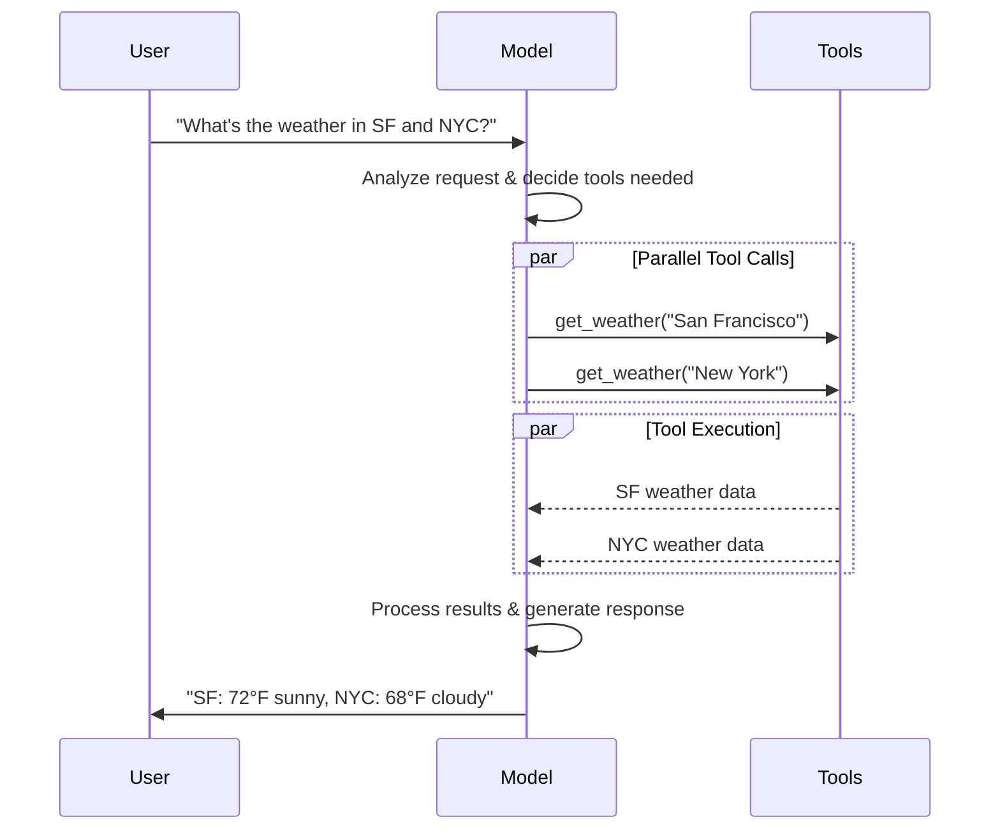

[LLMs](https://en.wikipedia.org/wiki/Large_language_model) are powerful AI tools that can interpret and generate text like humans. They're versatile enough to write content, translate languages, summarize, and answer questions without needing specialized training for each task.

In addition to text generation, many models support:

*  [Tool calling](#tool-calling) - calling external tools (like databases queries or API calls) and use results in their responses.
*  [Structured output](#structured-output) - where the model's response is constrained to follow a defined format.
*  [Multimodality](#multimodal) - process and return data other than text, such as images, audio, and video.
*  [Reasoning](#reasoning) - models perform multi-step reasoning to arrive at a conclusion.

Models are the reasoning engine of [agents](/oss/langchain/agents). They drive the agent's decision-making process, determining which tools to call, how to interpret results, and when to provide a final answer.

The quality and capabilities of the model you choose directly impact your agent's baseline reliability and performance. Different models excel at different tasks - some are better at following complex instructions, others at structured reasoning, and some support larger context windows for handling more information.

LangChain's standard model interfaces give you access to many different provider integrations, which makes it easy to experiment with and switch between models to find the best fit for your use case.

For provider-specific integration information and capabilities, see the provider's [chat model page](/oss/integrations/chat).

[LangSmith](/langsmith/observability) traces each model call so you can compare providers, inspect tool routing, and debug failures. Follow the [tracing quickstart](/langsmith/trace-with-langchain) to get set up.

We recommend you also set up [LangSmith Engine](/langsmith/engine) which monitors your traces, detects issues, and proposes fixes.

## Basic usage

Models can be utilized in two ways:

1. **With agents** - Models can be dynamically specified when creating an [agent](/oss/langchain/agents#model).
2. **Standalone** - Models can be called directly (outside of the agent loop) for tasks like text generation, classification, or extraction without the need for an agent framework.

The same model interface works in both contexts, which gives you the flexibility to start simple and scale up to more complex agent-based workflows as needed.

### Initialize a model

The easiest way to get started with a standalone model in LangChain is to use @[`init_chat_model`] to initialize one from a chat model provider of your choice (examples below):

```python
response = model.invoke("Why do parrots talk?")
```

See @[`init_chat_model`][init_chat_model] for more detail, including information on how to pass model [parameters](#parameters).

<ParamField body="api_key" type="string">
    The key required for authenticating with the model's provider. This is usually issued when you sign up for access to the model. Often accessed by setting an <Tooltip tip="A variable whose value is set outside the program, typically through functionality built into the operating system or microservice.">environment variable</Tooltip>.
</ParamField>

<ParamField body="max_tokens" type="number">
    Limits the total number of <Tooltip tip="The basic unit that a model reads and generates. Providers may define them differently, but in general, they can represent a whole or part of word.">tokens</Tooltip> in the response, effectively controlling how long the output can be.
</ParamField>

<ParamField body="max_retries" type="number" default="6">
    The maximum number of attempts the system will make to resend a request if it fails due to issues like network timeouts or rate limits. Retries use exponential backoff with jitter. Network errors, rate limits (429), and server errors (5xx) are retried automatically. Client errors such as 401 (unauthorized) or 404 are not retried. For long-running [agent](/oss/deepagents/overview) tasks on unreliable networks, consider increasing this to 10–15.
</ParamField>

Using @[`init_chat_model`], pass these parameters as inline <Tooltip tip="Arbitrary keyword arguments" cta="Learn more" href="https://www.w3schools.com/python/python_args_kwargs.asp">`**kwargs`</Tooltip>:

```python Initialize using model parameters
model = init_chat_model(
    "claude-sonnet-4-6",
    # Kwargs passed to the model:
    temperature=0.7,
    timeout=30,
    max_tokens=1000,
    max_retries=6,  # Default; increase for unreliable networks
)
```

You can adjust `max_retries` and `timeout` when creating a model, then pass that instance to `create_agent`, `create_deep_agent`, or call it standalone:

```python
from langchain.chat_models import init_chat_model

model = init_chat_model(
    "google_genai:gemini-3.6-flash",
    max_retries=10,  # Increase for unreliable networks (default: 6)
    timeout=120,  # Seconds; increase for slow connections
)
```

```python Single message
response = model.invoke("Why do parrots have colorful feathers?")
print(response)
```

```python Dictionary format
conversation = [
    {"role": "system", "content": "You are a helpful assistant that translates English to French."},
    {"role": "user", "content": "Translate: I love programming."},
    {"role": "assistant", "content": "J'adore la programmation."},
    {"role": "user", "content": "Translate: I love building applications."}
]

response = model.invoke(conversation)
print(response)  # AIMessage("J'adore créer des applications.")
```
```python Message objects
from langchain.messages import HumanMessage, AIMessage, SystemMessage

conversation = [
    SystemMessage("You are a helpful assistant that translates English to French."),
    HumanMessage("Translate: I love programming."),
    AIMessage("J'adore la programmation."),
    HumanMessage("Translate: I love building applications.")
]

response = model.invoke(conversation)
print(response)  # AIMessage("J'adore créer des applications.")
```

    ```python Basic text streaming
    for chunk in model.stream("Why do parrots have colorful feathers?"):
        print(chunk.text, end="|", flush=True)
    ```

    ```python Stream tool calls, reasoning, and other content
    for chunk in model.stream("What color is the sky?"):
        for block in chunk.content_blocks:
            if block["type"] == "reasoning" and (reasoning := block.get("reasoning")):
                print(f"Reasoning: {reasoning}")
            elif block["type"] == "tool_call_chunk":
                print(f"Tool call chunk: {block}")
            elif block["type"] == "text":
                print(block["text"])
            else:
                ...
    ```

```python Construct an AIMessage
full = None  # None | AIMessageChunk
for chunk in model.stream("What color is the sky?"):
    full = chunk if full is None else full + chunk
    print(full.text)

# The
# The sky
# The sky is
# The sky is typically
# The sky is typically blue
# ...

print(full.content_blocks)
# [{"type": "text", "text": "The sky is typically blue..."}]
```

        LangChain chat models can also stream semantic events using `astream_events()`.

        This simplifies filtering based on event types and other metadata, and will aggregate the full message in the background. See below for an example.

        ```python
        async for event in model.astream_events("Hello"):

            if event["event"] == "on_chat_model_start":
                print(f"Input: {event['data']['input']}")

            elif event["event"] == "on_chat_model_stream":
                print(f"Token: {event['data']['chunk'].text}")

            elif event["event"] == "on_chat_model_end":
                print(f"Full message: {event['data']['output'].text}")

            else:
                pass
        ```
        ```txt
        Input: Hello
        Token: Hi
        Token:  there
        Token: !
        Token:  How
        Token:  can
        Token:  I
        ...
        Full message: Hi there! How can I help today?
        ```

        
            See the @[`astream_events()`][BaseChatModel.astream_events] reference for event types and other details.
        
        

        
        Callback events allow LangGraph `stream()` and `astream_events()` to surface the chat model's output in real-time.
        
        
```python Batch
responses = model.batch([
    "Why do parrots have colorful feathers?",
    "How do airplanes fly?",
    "What is quantum computing?"
])
for response in responses:
    print(response)
```

<Note>
    This section describes a chat model method @[`batch()`][BaseChatModel.batch], which parallelizes model calls client-side.

    It is **distinct** from batch APIs supported by inference providers, such as [OpenAI](https://platform.openai.com/docs/guides/batch) or [Anthropic](https://platform.claude.com/docs/en/build-with-claude/batch-processing#message-batches-api).
</Note>

By default, @[`batch()`][BaseChatModel.batch] will only return the final output for the entire batch. If you want to receive the output for each individual input as it finishes generating, you can stream results with @[`batch_as_completed()`][BaseChatModel.batch_as_completed]:

```python Yield batch responses upon completion
for response in model.batch_as_completed([
    "Why do parrots have colorful feathers?",
    "How do airplanes fly?",
    "What is quantum computing?"
]):
    print(response)
```
<Note>
    When using @[`batch_as_completed()`][BaseChatModel.batch_as_completed], results may arrive out of order. Each includes the input index for matching to reconstruct the original order as needed.
</Note>

    When processing a large number of inputs using @[`batch()`][BaseChatModel.batch] or @[`batch_as_completed()`][BaseChatModel.batch_as_completed], you may want to control the maximum number of parallel calls. This can be done by setting the @[`max_concurrency`][RunnableConfig(max_concurrency)] attribute in the @[`RunnableConfig`] dictionary.

    ```python Batch with max concurrency
    model.batch(
        list_of_inputs,
        config={
            'max_concurrency': 5,  # Limit to 5 parallel calls
        }
    )
    ```

    See the @[`RunnableConfig`] reference for a full list of supported attributes.

For more details on batching, see the @[reference][BaseChatModel.batch].



To make tools that you have defined available for use by a model, you must bind them using @[`bind_tools`][BaseChatModel.bind_tools]. In subsequent invocations, the model can choose to call any of the bound tools as needed.

```python Binding user tools
from langchain.tools import tool

@tool
def get_weather(location: str) -> str:
    """Get the weather at a location."""
    return f"It's sunny in {location}."

model_with_tools = model.bind_tools([get_weather])  # [!code highlight]

response = model_with_tools.invoke("What's the weather like in Boston?")
for tool_call in response.tool_calls:
    # View tool calls made by the model
    print(f"Tool: {tool_call['name']}")
    print(f"Args: {tool_call['args']}")
```

        ```python Tool execution loop
        # Bind (potentially multiple) tools to the model
        tools = [get_weather]
        tools_by_name = {tool.name: tool for tool in tools}
        model_with_tools = model.bind_tools(tools)

        # Step 1: Model generates tool calls
        messages = [{"role": "user", "content": "What's the weather in Boston?"}]
        ai_msg = model_with_tools.invoke(messages)
        messages.append(ai_msg)

        # Step 2: Execute tools and collect results
        for tool_call in ai_msg.tool_calls:
            # Execute the tool with the generated arguments
            tool = tools_by_name[tool_call["name"]]
            tool_result = tool.invoke(tool_call)
            messages.append(tool_result)

        # Step 3: Pass results back to model for final response
        final_response = model_with_tools.invoke(messages)
        print(final_response.text)
        # "The current weather in Boston is 72°F and sunny."
        ```

        
        

        
            ```python Force use of any tool
            model_with_tools = model.bind_tools([tool_1], tool_choice="any")
            ```
            ```python Force use of specific tools
            model_with_tools = model.bind_tools([tool_1], tool_choice="tool_1")
            ```
        

        
        

        ```python Parallel tool calls
        tools = [get_weather]
        tools_by_name = {tool.name: tool for tool in tools}
        model_with_tools = model.bind_tools(tools)

        response = model_with_tools.invoke(
            "What's the weather in Boston and Tokyo?"
        )

        # The model may generate multiple tool calls
        print(response.tool_calls)
        # [
        #   {'name': 'get_weather', 'args': {'location': 'Boston'}, 'id': 'call_1'},
        #   {'name': 'get_weather', 'args': {'location': 'Tokyo'}, 'id': 'call_2'},
        # ]

        # Execute all tools (can be done in parallel with async)
        results = []
        for tool_call in response.tool_calls:
            tool = tools_by_name[tool_call["name"]]
            result = tool.invoke(tool_call)
            results.append(result)
        ```

        
        

        ```python Streaming tool calls
        for chunk in model_with_tools.stream(
            "What's the weather in Boston and Tokyo?"
        ):
            # Tool call chunks arrive progressively
            for tool_chunk in chunk.tool_call_chunks:
                if name := tool_chunk.get("name"):
                    print(f"Tool: {name}")
                if id_ := tool_chunk.get("id"):
                    print(f"ID: {id_}")
                if args := tool_chunk.get("args"):
                    print(f"Args: {args}")

        # Output:
        # Tool: get_weather
        # ID: call_SvMlU1TVIZugrFLckFE2ceRE
        # Args: {"lo
        # Args: catio
        # Args: n": "B
        # Args: osto
        # Args: n"}
        # Tool: get_weather
        # ID: call_QMZdy6qInx13oWKE7KhuhOLR
        # Args: {"lo
        # Args: catio
        # Args: n": "T
        # Args: okyo
        # Args: "}
        ```

        You can accumulate chunks to build complete tool calls:

        ```python Accumulate tool calls
        gathered = None
        for chunk in model_with_tools.stream("What's the weather in Boston?"):
            gathered = chunk if gathered is None else gathered + chunk
            print(gathered.tool_calls)
        ```

        
        

    
        [Pydantic models](https://docs.pydantic.dev/latest/concepts/models/#basic-model-usage) provide the richest feature set with field validation, descriptions, and nested structures.

        ```python
        from pydantic import BaseModel, Field

        class Movie(BaseModel):
            """A movie with details."""
            title: str = Field(description="The title of the movie")
            year: int = Field(description="The year the movie was released")
            director: str = Field(description="The director of the movie")
            rating: float = Field(description="The movie's rating out of 10")

        model_with_structure = model.with_structured_output(Movie)
        response = model_with_structure.invoke("Provide details about the movie Inception")
        print(response)  # Movie(title="Inception", year=2010, director="Christopher Nolan", rating=8.8)
        ```
    
    
        Python's `TypedDict` provides a simpler alternative to Pydantic models, ideal when you don't need runtime validation.

        ```python
        from typing_extensions import TypedDict, Annotated

        class MovieDict(TypedDict):
            """A movie with details."""
            title: Annotated[str, ..., "The title of the movie"]
            year: Annotated[int, ..., "The year the movie was released"]
            director: Annotated[str, ..., "The director of the movie"]
            rating: Annotated[float, ..., "The movie's rating out of 10"]

        model_with_structure = model.with_structured_output(MovieDict)
        response = model_with_structure.invoke("Provide details about the movie Inception")
        print(response)  # {'title': 'Inception', 'year': 2010, 'director': 'Christopher Nolan', 'rating': 8.8}
        ```
    
    
        Provide a [JSON Schema](https://json-schema.org/understanding-json-schema/about) for maximum control and interoperability.

        ```python
        import json

        json_schema = {
            "title": "Movie",
            "description": "A movie with details",
            "type": "object",
            "properties": {
                "title": {
                    "type": "string",
                    "description": "The title of the movie"
                },
                "year": {
                    "type": "integer",
                    "description": "The year the movie was released"
                },
                "director": {
                    "type": "string",
                    "description": "The director of the movie"
                },
                "rating": {
                    "type": "number",
                    "description": "The movie's rating out of 10"
                }
            },
            "required": ["title", "year", "director", "rating"]
        }

        model_with_structure = model.with_structured_output(
            json_schema,
            method="json_schema",
        )
        response = model_with_structure.invoke("Provide details about the movie Inception")
        print(response)  # {'title': 'Inception', 'year': 2010, ...}
        ```
    

<Note>
    **Key considerations for structured output**

    - **Method parameter**: Some providers support different methods for structured output:
        - `'json_schema'`: Uses dedicated structured output features offered by the provider.
        - `'function_calling'`: Derives structured output by forcing a [tool call](#tool-calling) that follows the given schema.
        - `'json_mode'`: A precursor to `'json_schema'` offered by some providers. Generates valid JSON, but the schema must be described in the prompt.
    - **Include raw**: Set `include_raw=True` to get both the parsed output and the raw AI message.
    - **Validation**: Pydantic models provide automatic validation. `TypedDict` and JSON Schema require manual validation.

    See your [provider's integration page](/oss/integrations/providers/overview) for supported methods and configuration options.
</Note>

    ```python
    from pydantic import BaseModel, Field

    class Movie(BaseModel):
        """A movie with details."""
        title: str = Field(description="The title of the movie")
        year: int = Field(description="The year the movie was released")
        director: str = Field(description="The director of the movie")
        rating: float = Field(description="The movie's rating out of 10")

    model_with_structure = model.with_structured_output(Movie, include_raw=True)  # [!code highlight]
    response = model_with_structure.invoke("Provide details about the movie Inception")
    response
    # {
    #     "raw": AIMessage(...),
    #     "parsed": Movie(title=..., year=..., ...),
    #     "parsing_error": None,
    # }
    ```
    

    
    
        ```python Pydantic BaseModel
        from pydantic import BaseModel, Field

        class Actor(BaseModel):
            name: str
            role: str

        class MovieDetails(BaseModel):
            title: str
            year: int
            cast: list[Actor]
            genres: list[str]
            budget: float | None = Field(None, description="Budget in millions USD")

        model_with_structure = model.with_structured_output(MovieDetails)
        ```

        ```python TypedDict
        from typing_extensions import Annotated, TypedDict

        class Actor(TypedDict):
            name: str
            role: str

        class MovieDetails(TypedDict):
            title: str
            year: int
            cast: list[Actor]
            genres: list[str]
            budget: Annotated[float | None, ..., "Budget in millions USD"]

        model_with_structure = model.with_structured_output(MovieDetails)
        ```
    
    

    
LangChain chat models can expose a dictionary of supported features and capabilities through a `profile` attribute:

```python
model.profile
# {
#   "max_input_tokens": 400000,
#   "image_inputs": True,
#   "reasoning_output": True,
#   "tool_calling": True,
#   ...
# }
```

Refer to the full set of fields in the [API reference](https://reference.langchain.com/python/langchain-core/language_models/model_profile/ModelProfile).

Much of the model profile data is powered by the [models.dev](https://github.com/sst/models.dev) project, an open source initiative that provides model capability data. These data are augmented with additional fields for purposes of use with LangChain. These augmentations are kept aligned with the upstream project as it evolves.

Model profile data allow applications to work around model capabilities dynamically. For example:

1. [Summarization middleware](/oss/langchain/middleware/built-in#summarization) can trigger summarization based on a model's context window size.
2. [Structured output](/oss/langchain/structured-output) strategies in `create_agent` can be inferred automatically (e.g., by checking support for native structured output features).
3. Model inputs can be gated based on supported [modalities](#multimodal) and maximum input tokens.
4. [Deep Agents Code](/oss/deepagents/code) filters the [interactive model switcher](/oss/deepagents/code/providers#which-models-appear-in-the-switcher) to models whose profiles report `tool_calling` support and text I/O, and displays context window sizes and capability flags in the selector detail view.

    Model profile data can be changed if it is missing, stale, or incorrect.

    **Option 1 (quick fix)**

    You can instantiate a chat model with any valid profile:

    ```python
    custom_profile = {
        "max_input_tokens": 100_000,
        "tool_calling": True,
        "structured_output": True,
        # ...
    }
    model = init_chat_model("...", profile=custom_profile)
    ```

    The `profile` is also a regular `dict` and can be updated in place. If the model instance is shared, consider using `model_copy` to avoid mutating shared state.

    ```python
    new_profile = model.profile | {"key": "value"}
    model.model_copy(update={"profile": new_profile})
    ```

    **Option 2 (fix data upstream)**

    The primary source for the data is the [models.dev](https://models.dev/) project. This data is merged with additional fields and overrides in LangChain [integration packages](/oss/integrations/providers/overview) and are shipped with those packages.

    Model profile data can be updated through the following process:

    1. (If needed) update the source data at [models.dev](https://models.dev/) through a pull request to its [repository on GitHub](https://github.com/sst/models.dev).
    2. (If needed) update additional fields and overrides in `langchain_<package>/data/profile_augmentations.toml` through a pull request to the LangChain [integration package](/oss/integrations/providers/overview)`.
    3. Use the [`langchain-model-profiles`](https://pypi.org/project/langchain-model-profiles/) CLI tool to pull the latest data from [models.dev](https://models.dev/), merge in the augmentations and update the profile data:
    
        ```bash pip
        pip install -U langchain-model-profiles
        ```

        ```bash uv
        uv add langchain-model-profiles
        ```
    

    ```bash
    langchain-profiles refresh --provider <provider> --data-dir <data_dir>
    ```

    This command:
    - Downloads the latest data for `<provider>` from models.dev
    - Merges augmentations from `profile_augmentations.toml` in `<data_dir>`
    - Writes merged profiles to `profiles.py` in `<data_dir>`

    For example: from [`libs/partners/anthropic`](https://github.com/langchain-ai/langchain/tree/master/libs/partners/anthropic) in the [LangChain monorepo](https://github.com/langchain-ai/langchain):

    ```bash
    uv run --with langchain-model-profiles --provider anthropic --data-dir langchain_anthropic/data
    ```

```python Multimodal output
response = model.invoke("Create a picture of a cat")
print(response.content_blocks)
# [
#     {"type": "text", "text": "Here's a picture of a cat"},
#     {"type": "image", "base64": "...", "mime_type": "image/jpeg"},
# ]
```

    ```python Stream reasoning output
    for chunk in model.stream("Why do parrots have colorful feathers?"):
        reasoning_steps = [r for r in chunk.content_blocks if r["type"] == "reasoning"]
        print(reasoning_steps if reasoning_steps else chunk.text)
    ```

    ```python Complete reasoning output
    response = model.invoke("Why do parrots have colorful feathers?")
    reasoning_steps = [b for b in response.content_blocks if b["type"] == "reasoning"]
    print(" ".join(step["reasoning"] for step in reasoning_steps))
    ```

<Note>
    `reasoning_effort` as a standard parameter requires `langchain-core>=1.5.2`, plus the corresponding partner package version: `langchain-anthropic>=1.5.3`, `langchain-openai>=1.4.1`, `langchain-fireworks>=1.5.2`, `langchain-xai>=1.3.0`, `langchain-google-genai>=4.3.1`, or `langchain-aws>=1.7.0`.
</Note>

@[`ChatOpenAI`], @[`ChatAnthropic`], @[`ChatFireworks`], @[`ChatXAI`], @[`ChatGoogleGenerativeAI`], and [`ChatBedrockConverse`](https://reference.langchain.com/python/langchain-aws/chat_models/bedrock_converse/ChatBedrockConverse) support a standard `reasoning_effort` parameter. Like `temperature`, it can be set at model construction or per invocation, and each provider translates it into its own API format:

```python
from langchain_anthropic import ChatAnthropic

model = ChatAnthropic(model="claude-sonnet-4-6")
response = model.invoke(
    "Why do parrots have colorful feathers?",
    reasoning_effort="high",
)
```

Supported effort levels and the provider's documented default vary by model. Check a model's [profile](#model-profiles) for the levels it supports and its default:

```python
model.profile["reasoning_effort_levels"]  # e.g. ['low', 'medium', 'high']
model.profile["reasoning_effort_default"]  # e.g. 'high'
```

Some providers also accept a native alias for `reasoning_effort` (for example, `ChatAnthropic` accepts `effort` and `ChatGoogleGenerativeAI` accepts `thinking_level`). See the [chat model integrations](/oss/integrations/chat) page for provider-specific detail.

For details, see the [integrations page](/oss/integrations/providers/overview) or [reference](https://reference.langchain.com/python/integrations/) for your respective chat model.

### Local models

LangChain supports running models locally on your own hardware. This is useful for scenarios where either data privacy is critical, you want to invoke a custom model, or when you want to avoid the costs incurred when using a cloud-based model.

[Ollama](/oss/integrations/chat/ollama) is one of the easiest ways to run chat and embedding models locally.

{/* TODO: whenever we have a better integrations directory, x-ref to that page with a local query filter */}

### Prompt caching

Many providers offer prompt caching features to reduce latency and cost on repeat processing of the same tokens. You can engage caching at three levels:

- **Implicit provider caching:** providers automatically pass on cost savings if a request hits a cache, with no configuration required. Examples: [OpenAI](/oss/integrations/chat/openai) and [Gemini](/oss/integrations/chat/google_generative_ai).
- **Provider-level explicit controls:** providers let you manually indicate cache points for greater control or to guarantee cost savings. These mirror the underlying provider/API behavior. Examples:
    - @[`ChatOpenAI`] (via `prompt_cache_key`)
    - Anthropic content-block [`cache_control`](/oss/integrations/chat/anthropic#prompt-caching)
    - [Gemini](https://reference.langchain.com/python/langchain-google-genai).

    - AWS Bedrock [`cachePoint`](/oss/integrations/chat/bedrock#prompt-caching) blocks
- **LangChain middleware:** for agents, middleware lets LangChain optimize caching of stable system prompt and tool content. Examples:
    - Anthropic's [`AnthropicPromptCachingMiddleware`](/oss/integrations/middleware/anthropic#prompt-caching)
    - AWS Bedrock's [`BedrockPromptCachingMiddleware`](/oss/integrations/middleware/aws#prompt-caching)

    Prompt caching is often only engaged above a minimum input token threshold. See [provider pages](/oss/integrations/chat) for details.

Cache usage will be reflected in the [usage metadata](/oss/langchain/messages#token-usage) of the model response.

### Server-side tool use

Some providers support server-side [tool-calling](#tool-calling) loops: models can interact with web search, code interpreters, and other tools and analyze the results in a single conversational turn.

If a model invokes a tool server-side, the content of the response message will include content representing the invocation and result of the tool. Accessing the [content blocks](/oss/langchain/messages#standard-content-blocks) of the response will return the server-side tool calls and results in a provider-agnostic format:

```python Invoke with server-side tool use
from langchain.chat_models import init_chat_model

model = init_chat_model("gpt-5.4-mini")

tool = {"type": "web_search"}
model_with_tools = model.bind_tools([tool])

response = model_with_tools.invoke("What was a positive news story from today?")
print(response.content_blocks)
```
```python Result expandable
[
    {
        "type": "server_tool_call",
        "name": "web_search",
        "args": {
            "query": "positive news stories today",
            "type": "search"
        },
        "id": "ws_abc123"
    },
    {
        "type": "server_tool_result",
        "tool_call_id": "ws_abc123",
        "status": "success"
    },
    {
        "type": "text",
        "text": "Here are some positive news stories from today...",
        "annotations": [
            {
                "end_index": 410,
                "start_index": 337,
                "title": "article title",
                "type": "citation",
                "url": "..."
            }
        ]
    }
]
```

### Model exceptions

Major integration packages raise standard exception types from `langchain_core.exceptions` for common model failures such as authentication errors, rate limits, and timeouts. These exceptions inherit from both the LangChain base type and the provider SDK's own exception type, so you can catch either one:

```python
from langchain.chat_models import init_chat_model
from langchain_core.exceptions import ModelTimeoutError

model = init_chat_model("openai:gpt-5.6-luna", timeout=0.0001)

try:
    response = model.invoke("Hello")
except ModelTimeoutError:
    print("caught")
```

Each type carries an `is_retryable` attribute that [retry middleware](/oss/langchain/middleware/built-in#model-retry) respects by default.

- @[`ModelAuthenticationError`] — missing, invalid, or expired API key (not retryable)
- @[`ModelPermissionDeniedError`] — credentials lack permission (not retryable)
- @[`ModelInvalidRequestError`] — provider rejects the request (not retryable)
- @[`ModelNotFoundError`] — requested model not found (not retryable)
- @[`ModelRateLimitError`] — provider rate limit exceeded (retryable)
- @[`ModelAPIError`] — provider server failure (retryable)
- @[`ModelConnectionError`] — provider cannot be reached (retryable)
- @[`ModelTimeoutError`] — request times out (retryable)
- @[`ContextOverflowError`] — input exceeds the model context limit (not retryable)

### Rate limiting

Many chat model providers impose a limit on the number of invocations that can be made in a given time period. If you hit a rate limit, you will typically receive a rate limit error response from the provider, and will need to wait before making more requests.

To help manage rate limits, chat model integrations accept a `rate_limiter` parameter that can be provided during initialization to control the rate at which requests are made.

    LangChain comes with (an optional) built-in @[`InMemoryRateLimiter`]. This limiter is thread safe and can be shared by multiple threads in the same process.

    ```python Define a rate limiter
    from langchain.rate_limiters import InMemoryRateLimiter

    rate_limiter = InMemoryRateLimiter(
        requests_per_second=0.1,  # 1 request every 10s
        check_every_n_seconds=0.1,  # Check every 100ms whether allowed to make a request
        max_bucket_size=10,  # Controls the maximum burst size.
    )

    model = init_chat_model(
        model="gpt-5.5",
        model_provider="openai",
        rate_limiter=rate_limiter  # [!code highlight]
    )
    ```

    
        The provided rate limiter can only limit the number of requests per unit time. It will not help if you need to also limit based on the size of the requests.
    

### Base URL and proxy settings

You can configure a custom base URL for providers that implement the OpenAI Chat Completions API.

    `model_provider="openai"` (or direct `ChatOpenAI` usage) targets the official OpenAI API specification. Provider-specific fields from routers and proxies may not be extracted or preserved.

    For OpenRouter and LiteLLM, prefer the dedicated integrations:
    - [OpenRouter via `ChatOpenRouter`](/oss/integrations/chat/openrouter) (`langchain-openrouter`)
    - [LiteLLM via `ChatLiteLLM` / `ChatLiteLLMRouter`](/oss/integrations/chat) (`langchain-litellm`)

    
    Many model providers offer OpenAI-compatible APIs (e.g., [Together AI](https://www.together.ai/), [vLLM](https://github.com/vllm-project/vllm)). You can use @[`init_chat_model`] with these providers by specifying the appropriate `base_url` parameter:

    ```python
    model = init_chat_model(
        model="MODEL_NAME",
        model_provider="openai",
        base_url="BASE_URL",
        api_key="YOUR_API_KEY",
    )
    ```
    

    

    For deployments requiring HTTP proxies, some model integrations support proxy configuration:

    ```python
    from langchain_openai import ChatOpenAI

    model = ChatOpenAI(
        model="gpt-5.5",
        openai_proxy="http://proxy.example.com:8080"
    )
    ```

<Note>
    Proxy support varies by integration. Check the specific model provider's [reference](/oss/integrations/providers/overview) for proxy configuration options.
</Note>

### Log probabilities

Certain models can be configured to return token-level log probabilities representing the likelihood of a given token by setting the `logprobs` parameter when initializing the model:

```python
model = init_chat_model(
    model="gpt-5.5",
    model_provider="openai"
).bind(logprobs=True)

response = model.invoke("Why do parrots talk?")
print(response.response_metadata["logprobs"])
```

<Note>
    Some provider APIs, notably OpenAI and Azure OpenAI chat completions, require users opt-in to receiving token usage data in streaming contexts. See the [streaming usage metadata](/oss/integrations/chat/openai#streaming-usage-metadata) section of the integration guide for details.
</Note>

You can track aggregate token counts across models in an application using either a callback or context manager, as shown below:

    
        ```python
        from langchain.chat_models import init_chat_model
        from langchain_core.callbacks import UsageMetadataCallbackHandler

        model_1 = init_chat_model(model="gpt-5.4-mini")
        model_2 = init_chat_model(model="claude-haiku-4-5-20251001")

        callback = UsageMetadataCallbackHandler()
        result_1 = model_1.invoke("Hello", config={"callbacks": [callback]})
        result_2 = model_2.invoke("Hello", config={"callbacks": [callback]})
        print(callback.usage_metadata)
        ```
        ```python
        {
            'gpt-5.4-mini': {
                'input_tokens': 8,
                'output_tokens': 10,
                'total_tokens': 18,
                'input_token_details': {'audio': 0, 'cache_read': 0},
                'output_token_details': {'audio': 0, 'reasoning': 0}
            },
            'claude-haiku-4-5-20251001': {
                'input_tokens': 8,
                'output_tokens': 21,
                'total_tokens': 29,
                'input_token_details': {'cache_read': 0, 'cache_creation': 0}
            }
        }
        ```
    
    
        ```python
        from langchain.chat_models import init_chat_model
        from langchain_core.callbacks import get_usage_metadata_callback

        model_1 = init_chat_model(model="gpt-5.4-mini")
        model_2 = init_chat_model(model="claude-haiku-4-5-20251001")

        with get_usage_metadata_callback() as cb:
            model_1.invoke("Hello")
            model_2.invoke("Hello")
            print(cb.usage_metadata)
        ```
        ```python
        {
            'gpt-5.4-mini': {
                'input_tokens': 8,
                'output_tokens': 10,
                'total_tokens': 18,
                'input_token_details': {'audio': 0, 'cache_read': 0},
                'output_token_details': {'audio': 0, 'reasoning': 0}
            },
            'claude-haiku-4-5-20251001': {
                'input_tokens': 8,
                'output_tokens': 21,
                'total_tokens': 29,
                'input_token_details': {'cache_read': 0, 'cache_creation': 0}
            }
        }
        ```
    

### Invocation config

When invoking a model, you can pass additional configuration through the `config` parameter using a @[`RunnableConfig`] dictionary. This provides run-time control over execution behavior, callbacks, and metadata tracking.

```python Invocation with config
response = model.invoke(
    "Tell me a joke",
    config={
        "run_name": "joke_generation",      # Custom name for this run
        "tags": ["humor", "demo"],          # Tags for categorization
        "metadata": {"user_id": "123"},     # Custom metadata
        "callbacks": [my_callback_handler], # Callback handlers
    }
)
```

    <ParamField body="run_name" type="string">
        Identifies this specific invocation in logs and traces. Not inherited by sub-calls.
    </ParamField>

    <ParamField body="tags" type="string[]">
        Labels inherited by all sub-calls for filtering and organization in debugging tools.
    </ParamField>

    <ParamField body="metadata" type="object">
        Custom key-value pairs for tracking additional context, inherited by all sub-calls.
    </ParamField>

    <ParamField body="max_concurrency" type="number">
        Controls the maximum number of parallel calls when using @[`batch()`][BaseChatModel.batch] or @[`batch_as_completed()`][BaseChatModel.batch_as_completed].
    </ParamField>

    <ParamField body="callbacks" type="array">
        Handlers for monitoring and responding to events during execution.
    </ParamField>

    <ParamField body="recursion_limit" type="number">
        Maximum recursion depth for chains to prevent infinite loops in complex pipelines.
    </ParamField>

### Configurable models

You can also create a runtime-configurable model by specifying @[`configurable_fields`][BaseChatModel.configurable_fields]. If you don't specify a model value, then `'model'` and `'model_provider'` will be configurable by default.

```python
from langchain.chat_models import init_chat_model

configurable_model = init_chat_model(temperature=0)

configurable_model.invoke(
    "what's your name",
    config={"configurable": {"model": "gpt-5-nano"}},  # Run with GPT-5-Nano
)
configurable_model.invoke(
    "what's your name",
    config={"configurable": {"model": "claude-sonnet-4-6"}},  # Run with Claude
)
```

    We can create a configurable model with default model values, specify which parameters are configurable, and add prefixes to configurable params:

    ```python
    first_model = init_chat_model(
            model="gpt-5.4-mini",
            temperature=0,
            configurable_fields=("model", "model_provider", "temperature", "max_tokens"),
            config_prefix="first",  # Useful when you have a chain with multiple models
    )

    first_model.invoke("what's your name")
    ```

    ```python
    first_model.invoke(
        "what's your name",
        config={
            "configurable": {
                "first_model": "claude-sonnet-4-6",
                "first_temperature": 0.5,
                "first_max_tokens": 100,
            }
        },
    )
    ```

    See the @[`init_chat_model`] reference for more details on `configurable_fields` and `config_prefix`.

    We can call declarative operations like `bind_tools`, `with_structured_output`, `with_configurable`, etc. on a configurable model and chain a configurable model in the same way that we would a regularly instantiated chat model object.

    ```python
    from pydantic import BaseModel, Field

    class GetWeather(BaseModel):
        """Get the current weather in a given location"""

            location: str = Field(description="The city and state, e.g. San Francisco, CA")

    class GetPopulation(BaseModel):
        """Get the current population in a given location"""

            location: str = Field(description="The city and state, e.g. San Francisco, CA")

    model = init_chat_model(temperature=0)
    model_with_tools = model.bind_tools([GetWeather, GetPopulation])

    model_with_tools.invoke(
        "what's bigger in 2024 LA or NYC", config={"configurable": {"model": "gpt-5.4-mini"}}
    ).tool_calls
    ```
    ```
    [
        {
            'name': 'GetPopulation',
            'args': {'location': 'Los Angeles, CA'},
            'id': 'call_Ga9m8FAArIyEjItHmztPYA22',
            'type': 'tool_call'
        },
        {
            'name': 'GetPopulation',
            'args': {'location': 'New York, NY'},
            'id': 'call_jh2dEvBaAHRaw5JUDthOs7rt',
            'type': 'tool_call'
        }
    ]
    ```
    ```python
    model_with_tools.invoke(
        "what's bigger in 2024 LA or NYC",
        config={"configurable": {"model": "claude-sonnet-4-6"}},
    ).tool_calls
    ```
    ```
    [
        {
            'name': 'GetPopulation',
            'args': {'location': 'Los Angeles, CA'},
            'id': 'toolu_01JMufPf4F4t2zLj7miFeqXp',
            'type': 'tool_call'
        },
        {
            'name': 'GetPopulation',
            'args': {'location': 'New York City, NY'},
            'id': 'toolu_01RQBHcE8kEEbYTuuS8WqY1u',
            'type': 'tool_call'
        }
    ]
    ```

### Dynamic model selection

Dynamic models are selected at <Tooltip tip="The execution environment of your agent, containing immutable configuration and contextual data that persists throughout the agent's execution (e.g., user IDs, session details, or application-specific configuration).">runtime</Tooltip> based on the current <Tooltip tip="The data that flows through your agent's execution, including messages, custom fields, and any information that needs to be tracked and potentially modified during processing (e.g., user preferences or tool usage stats).">state</Tooltip> and context. This enables sophisticated routing logic and cost optimization.

To use a dynamic model, create middleware using the @[`@wrap_model_call`] decorator that modifies the model in the request:

```python
from langchain_openai import ChatOpenAI
from langchain.agents import create_agent
from langchain.agents.middleware import wrap_model_call, ModelRequest, ModelResponse

basic_model = ChatOpenAI(model="gpt-5.4-mini")
advanced_model = ChatOpenAI(model="gpt-5.5")

@wrap_model_call
def dynamic_model_selection(request: ModelRequest, handler) -> ModelResponse:
    """Choose model based on conversation complexity."""
    message_count = len(request.state["messages"])

    if message_count > 10:
        # Use an advanced model for longer conversations
        model = advanced_model
    else:
        model = basic_model

    return handler(request.override(model=model))

agent = create_agent(
    model=basic_model,  # Default model
    tools=[],
    middleware=[dynamic_model_selection]
)
```

Pre-bound models (models with @[`bind_tools`][BaseChatModel.bind_tools] already called) are not supported when using structured output. If you need dynamic model selection with structured output, ensure the models passed to the middleware are not pre-bound.
